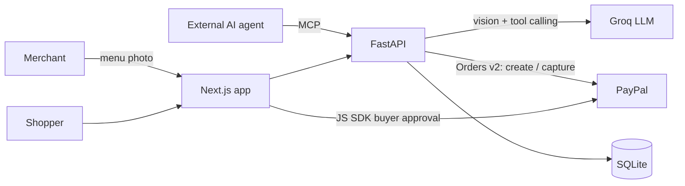

# SnapCart

**Turn a photo of a paper menu into a PayPal-ready store that people *and* AI agents can shop, in minutes.**

Millions of micro-merchants (street-food stalls, tea corners, home kitchens) have no website and no structured catalog, so neither online shoppers nor AI shopping agents can buy from them. SnapCart closes that gap:

1. **Snap**: the merchant photographs their menu. A vision LLM extracts products, prices, categories, and dietary tags, and flags anything it can't read.
2. **Review**: the merchant sees exactly what the AI read, fixes flagged items in an AG Grid, and publishes. Nothing goes live until every item is approved.
3. **Shop**: customers order from a mobile storefront, chat with an AI shopping assistant, or send their *own* AI agent through the built-in **MCP server**.
4. **Pay**: every order ends in PayPal Checkout. The server sets every price, the buyer approves in PayPal, and the server verifies the captured amount before marking an order paid.

> PayPal is the trust layer for agentic commerce: agents can choose, but only the server can price, and only the human can pay.

## What makes it different

| | |
|---|---|
| **Paper to payable** | One photo becomes a reviewed, published catalog with PayPal checkout. |
| **Agent-ready by default** | Every store is exposed to external AI agents (Claude, ChatGPT, custom) over MCP, with no merchant setup. |
| **Safe agent payments** | Agents get three narrow tools: read the menu, build a server-priced cart, check payment status. No tool can set a price or move money. Agent orders hand the human a checkout link to approve in PayPal. |
| **Human in the loop** | AI extraction is never auto-published; unclear prices block publishing until the merchant fixes them. |
| **Channel visibility** | The merchant ledger separates web orders from AI-agent orders, live. |

## How PayPal is used

- **Orders v2 API** (server side, [paypal_service.py](backend/app/services/paypal_service.py)): OAuth client-credentials, `POST /v2/checkout/orders` with `intent: CAPTURE`, and `POST /v2/checkout/orders/{id}/capture`, with `PayPal-Request-Id` headers.
- **Capture verification**: the API only marks an order paid when PayPal reports `COMPLETED` *and* the captured currency and amount exactly match the server-calculated order total. Mismatches mark the order failed.
- **PayPal JS SDK buttons** ([PayPalCheckoutButton.tsx](frontend/components/checkout/PayPalCheckoutButton.tsx)): the buyer approves in PayPal; the browser never sees secrets or decides the amount.
- **Agentic commerce**: AI-built carts (in-store assistant or external MCP agents) always end in PayPal buyer approval via `/checkout/{order}`.

## How AI is used

| Feature | Model / tool | Where |
|---|---|---|
| Menu photo → structured catalog | `qwen/qwen3.8-27b` (vision) on **Groq**, JSON output | [ai_extraction_service.py](backend/app/services/ai_extraction_service.py) |
| In-store shopping assistant | `qwen/qwen3.8-27b` on **Groq** with tool calling over bounded tools | [llm_shopping_agent.py](backend/app/services/llm_shopping_agent.py) |
| External agents | **MCP server** (official Python SDK, streamable HTTP + stdio) | [mcp_server.py](backend/app/mcp_server.py) |

The assistant grounds every turn in the live menu, respects budgets and dietary tags, asks a clarifying question when a request is ambiguous, and never quotes a total the server didn't compute. If Groq is unavailable it falls back to a deterministic rule-based planner, so the demo never dead-ends. Gemini is also supported for menu reading (`VISION_PROVIDER=gemini`).

## Sponsor tools

- **AG Grid**: editable catalog review grid (inline editing of names, categories, prices, dietary tags; per-row approve) and a live orders ledger with sorting, quick search, channel/status filters, and a pinned captured-total row. See [CatalogReviewGrid.tsx](frontend/components/catalog/CatalogReviewGrid.tsx) and [OrdersLedgerGrid.tsx](frontend/components/dashboard/OrdersLedgerGrid.tsx).
- **Render**: one-click deploy via [render.yaml](render.yaml).

## Quick start (local)

Requirements: Python 3.11+, Node 20+.

```bash
cp .env.example .env          # then add GROQ_API_KEY and PayPal sandbox keys
cd backend
python -m venv .venv
.venv/Scripts/activate        # macOS/Linux: source .venv/bin/activate
pip install -r requirements.txt
uvicorn app.main:app --port 8000
```

In a second terminal:

```bash
cd frontend
npm ci
npm run dev
```

Open http://localhost:3000 and follow the **Demo flow** bar across the top: Snap menu → Review & publish → Shop & pay with PayPal → Track orders. API docs are at http://localhost:8000/docs.

**No keys?** The app still runs end to end: `VISION_PROVIDER=mock` returns a fixed sample menu and `LLM_PROVIDER=none` uses the rule-based assistant. PayPal buttons appear once `NEXT_PUBLIC_PAYPAL_CLIENT_ID` and the server-side PayPal keys are set. Pay with a sandbox **Personal** account from the PayPal Developer Dashboard.

## Let an external AI agent shop (MCP)

The API serves an MCP endpoint at `http://localhost:8000/mcp` (streamable HTTP) with four tools: `list_stores`, `get_store_catalog`, `build_validated_cart`, and `check_order_payment_status`. `build_validated_cart` returns a `checkout_url` the human opens to approve the payment in PayPal.

**Claude Desktop / any stdio client** (`claude_desktop_config.json`):

```json
{
  "mcpServers": {
    "snapcart": {
      "command": "/absolute/path/to/SnapCart/backend/.venv/bin/python",
      "args": ["-m", "app.mcp_server"],
      "cwd": "/absolute/path/to/SnapCart/backend"
    }
  }
}
```

On Windows use `backend\\.venv\\Scripts\\python.exe`. Clients that support remote MCP servers can connect straight to the `/mcp` URL instead.

Try: *"Find a tea stall on SnapCart and order two milk teas and a snack under $3 for me."* The agent builds the cart and returns a checkout link; open it and approve in PayPal; the order appears in the merchant ledger as an **AI agent** order.

## Deploy to Render

Click **New → Blueprint** in Render and point it at this repo. [render.yaml](render.yaml) creates `snapcart-api` and `snapcart-web`. Then set:

- API: `GROQ_API_KEY`, `PAYPAL_CLIENT_ID`, `PAYPAL_CLIENT_SECRET`, `PUBLIC_APP_URL` and `CORS_ORIGINS` (the web service URL).
- Web: `NEXT_PUBLIC_API_URL` (the API URL) and `NEXT_PUBLIC_PAYPAL_CLIENT_ID`, then redeploy so the build picks them up.

The free tier uses SQLite on an ephemeral disk; the demo store is re-seeded on every start.

## Architecture



- `backend/`: FastAPI modular monolith (routes, SQLAlchemy models, services, MCP server) with a pytest suite covering pricing, publishing, PayPal verification, the LLM agent loop, and MCP tools.
- `frontend/`: Next.js App Router: storefront, assistant chat, checkout-by-link, merchant dashboard, AG Grid screens.
- More detail: [docs/architecture.md](docs/architecture.md), [docs/build-log.md](docs/build-log.md).

## Tests

```bash
cd backend && pytest       # offline: LLM and PayPal calls are stubbed
cd frontend && npx tsc --noEmit
```

## Security notes

- Secrets live only in the server environment; the frontend only gets the public PayPal client ID.
- Prices are always recomputed from the database; client and agent-supplied totals are ignored.
- Uploaded files are validated by signature and dimensions before reaching the AI.
- Demo scope: the merchant dashboard has no authentication and one seeded store is used. A production version would add merchant accounts and PayPal partner onboarding so payouts go straight to each merchant.

## License

[MIT](LICENSE)
