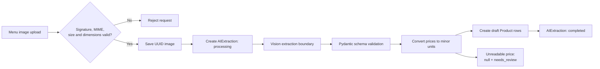
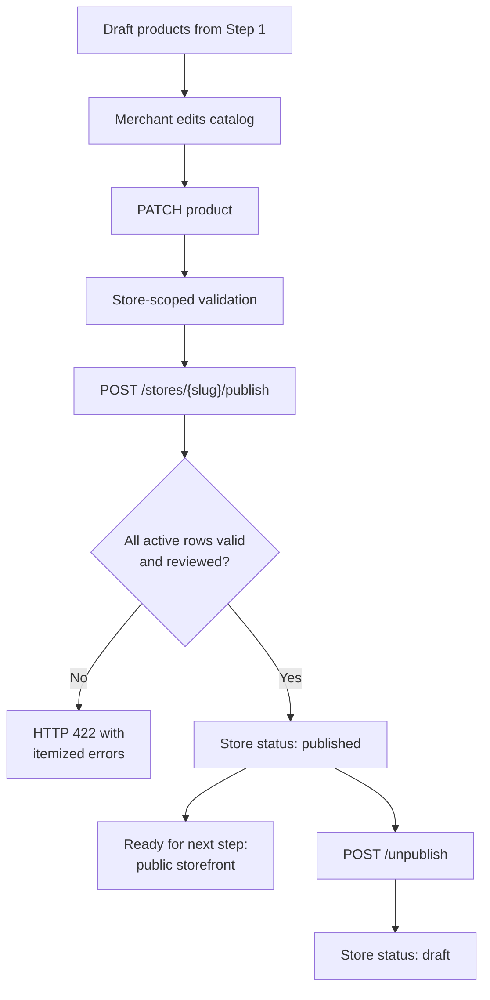
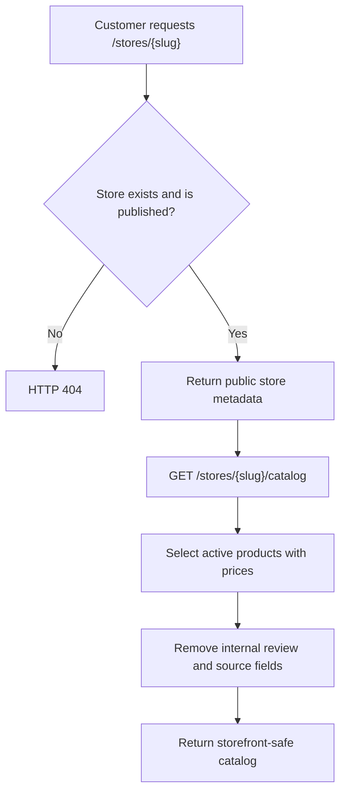
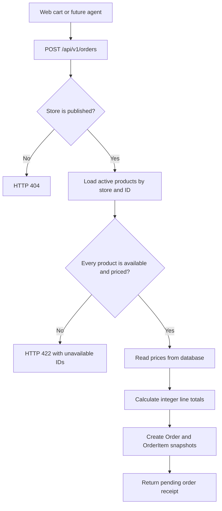
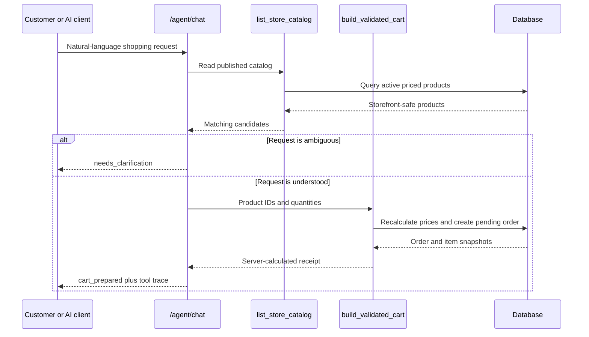
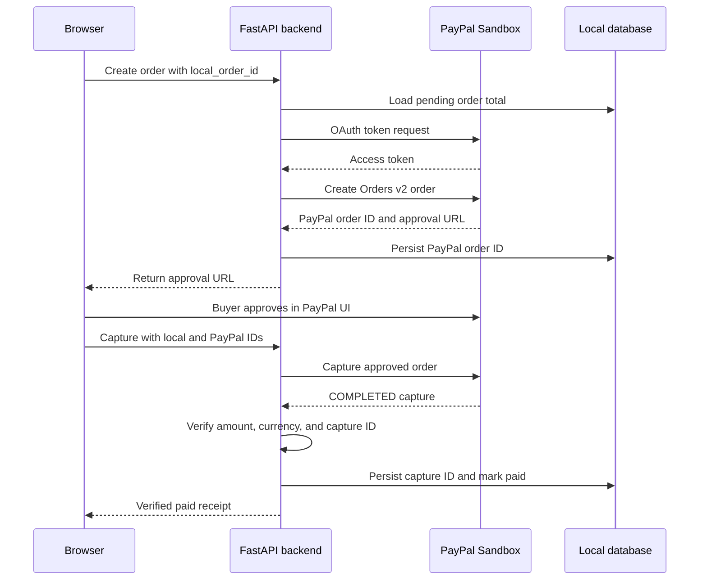

# SnapCart build log

SnapCart turns a menu photo into a reviewed catalog, a mobile storefront, and an agent-ready ordering node with PayPal Sandbox checkout.

## Repository layout

- `frontend/` — Next.js App Router UI, AG Grid review/order screens, storefront, and PayPal approval UI.
- `backend/` — FastAPI modular monolith containing API routes, models, schemas, services, and tests.
- `docs/` — project documentation and integration notes.

## Local setup

1. Copy `.env.example` to `.env` and fill in PayPal/AI credentials when using live integrations.
2. Start the backend:

   ```powershell
   cd backend
   .\.venv\Scripts\Activate.ps1
   uvicorn app.main:app --reload --port 8000
   ```

3. Start the frontend in a second terminal:

   ```powershell
   cd frontend
   npm run dev
   ```

The frontend runs at `http://localhost:3000`; API docs are at `http://localhost:8000/docs`.

The initial scaffold uses a mock vision provider and SQLite so it can run without external credentials. PayPal Sandbox and a real vision provider can be enabled through environment variables as implementation proceeds.

## Implementation progress

The build is being completed one milestone at a time. Steps 1–5 are implemented currently. PayPal payment processing remains intentionally untouched.

| Step | Capability | Status |
|---|---|---|
| 1 | Menu upload and AI extraction | Complete |
| 2 | Catalog review and publishing | Complete |
| 3 | Public storefront APIs | Complete |
| 4 | Server-validated cart and pending orders | Complete |
| 5 | Shopping-agent tools and orchestration | Complete |
| 6 | PayPal create, capture, and verification | Complete |

### Step 1 — Menu upload and AI extraction (complete)

The backend now exposes `POST /api/v1/catalog/extract`. It accepts a JPEG, PNG, or WebP menu image and:

1. validates the declared MIME type, file signature, upload size, and image dimensions;
2. stores the image under a UUID filename in `UPLOAD_DIRECTORY`;
3. creates an `AIExtraction` record with processing status;
4. runs the configured extraction boundary (the deterministic `mock` provider works without credentials);
5. validates the structured result with Pydantic;
6. converts decimal prices to integer minor units, such as `$1.50` → `150`;
7. converts unreadable or invalid prices to `null` and marks the draft product as needing review;
8. persists the extracted result and creates draft `Product` rows.

The endpoint does not publish a store or create orders. Publishing is handled by Step 2.



Example request:

```powershell
curl.exe -X POST http://localhost:8000/api/v1/catalog/extract `
  -F "file=@menu.png" `
  -F "store_slug=rinas-stall"
```

Important configuration values are documented in `.env.example`: `UPLOAD_DIRECTORY`, `MAX_UPLOAD_BYTES`, `VISION_PROVIDER`, `VISION_API_KEY`, `VISION_MODEL`, and `CORS_ORIGINS` (comma-separated browser origins allowed to call the API; defaults to `http://localhost:3000`). The default provider is `mock`; set `VISION_PROVIDER=gemini` to use the implemented Gemini structured-output adapter. The backend dependency is `google-genai`. Keep `VISION_API_KEY` in `backend/.env` and never expose it through a `NEXT_PUBLIC_*` variable.

For a real extraction test:

```powershell
cd backend
pip install -r requirements.txt
python -m uvicorn app.main:app --reload --port 8000
```

Then open `http://localhost:3000/dashboard/catalog/new` and upload a real menu image. Gemini receives the image bytes and the extraction prompt, returns JSON constrained to `ExtractionResult`, and the backend performs a second Pydantic validation before creating draft products. If Gemini cannot read a price, the backend preserves `price_minor=null` and `needs_review=true` for human correction.

Each new upload replaces the store's current active draft catalog. Previous product rows remain as inactive history, while the review screen and publish validation operate only on the newest active extraction. This prevents an older unreadable row from blocking a later publication.

Step 1 tests cover invalid image rejection and extraction-schema currency normalization. The full backend test suite can be run with:

```powershell
cd backend
pytest
```

### Step 2 — Catalog review and publishing (complete)

The merchant review workflow is now enforced by the backend. Extracted products can be edited through:

```text
GET   /api/v1/dashboard/catalog?store_slug=rinas-stall
PATCH /api/v1/dashboard/catalog/{product_id}?store_slug=rinas-stall
```

The update endpoint scopes the product lookup to the selected store. It accepts incomplete draft prices so an AI extraction can remain editable, but it automatically keeps `ai_needs_review=true` when the price is missing. Names and categories cannot be blank.

The review table also provides a `Delete` action for every active menu item:

```text
DELETE /api/v1/dashboard/catalog/{product_id}?store_slug=rinas-stall
```

This is a soft delete: the product is marked `is_active=false` and disappears from the active review catalog and storefront, while its database row remains available for historical order references. If the store was published, removing an item returns the store to `draft`, so the merchant must review and publish again.

Publishing is explicit and server-validated:

```text
POST /api/v1/stores/{slug}/publish
POST /api/v1/stores/{slug}/unpublish
```

The publish operation refuses to change the store to `published` when:

- there are no active products;
- an active product has no positive integer price;
- an active product uses a currency different from the store currency; or
- an active product still has `ai_needs_review=true`.

The response includes the store status, active catalog count, and currency. A failed publish returns HTTP 422 with an itemized list of catalog problems for the review UI. Unpublishing returns the store to `draft` without deleting products.



Step 2 tests cover successful publishing, rejection of items needing review, positive-price validation, and store-scoped catalog updates. It does not create orders or process payments.

If the browser displays `Store not found` at `/store/rinas-stall`, check the dashboard status first. Public store endpoints intentionally return 404 for a store in `draft`. Remove invalid items or correct their prices and review flags, then select **Publish store**. The public store becomes available only after that operation succeeds.

If Next.js displays a missing chunk error such as `Cannot find module './992.js'`, stop the frontend dev server, remove the generated `frontend/.next` directory, and restart it with `npm run dev`. The `.next` directory is a generated cache and is not application source.

### Step 3 — Public storefront APIs (complete)

Published stores can now be read through public, database-backed endpoints:

```text
GET /api/v1/stores/{slug}
GET /api/v1/stores/{slug}/catalog
```

Both endpoints return HTTP 404 for draft or unknown stores, so an unpublished store is not exposed through the public API. The catalog endpoint returns only active products with a non-null price and exposes only storefront-safe fields: name, description, integer minor-unit price, currency, category, and dietary tags. Internal fields such as `source_text`, `ai_needs_review`, and database relationships are excluded.

The catalog is ordered by category and then product ID to keep storefront rendering deterministic. The API does not create orders or calculate cart totals; those behaviors are implemented in Step 4.



Example requests:

```powershell
curl.exe http://localhost:8000/api/v1/stores/rinas-stall
curl.exe http://localhost:8000/api/v1/stores/rinas-stall/catalog
```

Step 3 tests verify published-store metadata, draft-store isolation, deterministic catalog output, and removal of internal product fields. Cart creation is implemented in Step 4; agent orchestration is implemented in Step 5.

### Step 4 — Server-validated cart and pending orders (complete)

The backend now creates a local pending order from either the visual storefront (`web`) or the shopping agent (`ai_agent`):

```text
POST /api/v1/orders
```

Request body:

```json
{
  "store_slug": "rinas-stall",
  "source": "web",
  "items": [
    { "product_id": 1, "quantity": 2 },
    { "product_id": 2, "quantity": 1 }
  ]
}
```

The cart service only accepts products from a published store that are active and priced. It ignores any client-supplied total, reloads product prices from the database, calculates each line total and the subtotal in integer minor units, and creates an order with `status="pending"`. There are currently no taxes, discounts, shipping fees, or service fees, so `total_minor` equals `subtotal_minor`.

Each order stores an `OrderItem` with a product ID, quantity, line total, and name/price snapshots. Snapshots preserve the amount and display name that were used when the order was prepared, even if the catalog is edited later. Invalid or unavailable product IDs return HTTP 422 and do not create a usable order.



Step 4 tests cover web-cart totals, unavailable products, AI-agent order source tracking, and persisted name/price snapshots. This step prepares a local order only; it does not call an AI model, create a PayPal order, capture funds, or mark an order as paid.

### Step 5 — Shopping-agent tools and orchestration (complete)

The shopping-agent boundary is deliberately limited to three tools:

| Tool | Endpoint | Behavior |
|---|---|---|
| `list_store_catalog` | `GET /api/v1/agent/stores/{slug}/catalog` | Reads the published, storefront-safe catalog. |
| `build_validated_cart` | `POST /api/v1/agent/stores/{slug}/cart` | Reuses the server cart service and creates a pending `ai_agent` order. |
| `check_order_payment_status` | `GET /api/v1/agent/stores/{slug}/orders/{id}/payment-status` | Reads local payment state without moving money. |

The conversational orchestration endpoint is:

```text
POST /api/v1/agent/chat
```

Example request:

```json
{
  "store_slug": "rinas-stall",
  "message": "Order two vegetable samosas and a mango lassi"
}
```

The current provider is deterministic and credential-free. It looks up the catalog, matches explicit product names or simple category/dietary requests, extracts quantities, applies a requested dollar budget when possible, calls `build_validated_cart`, and returns the tool-call trace plus the pending order receipt. If it cannot safely match the request, it returns `needs_clarification` and does not create an order.



The agent cannot publish products, edit the catalog, call PayPal, capture funds, or mark an order as paid. Human approval through the future PayPal UI remains mandatory. Step 5 tests cover catalog-tool output, successful orchestration, clarification behavior, and read-only payment-status lookup.

### Step 6 — PayPal create, capture, and verification (complete)

The server-side PayPal Sandbox flow is now available through:

```text
POST /api/v1/payments/paypal/create-order
POST /api/v1/payments/paypal/capture-order
GET  /api/v1/orders/{id}
```

The implementation follows PayPal's OAuth 2.0 and Orders v2 flow: the backend exchanges the client ID and secret for an access token, creates an Orders v2 order with `intent: CAPTURE`, returns the approval link to the browser, and captures only after the buyer approves the order. See PayPal's [OAuth authentication guide](https://developer.paypal.com/api/rest/authentication) and [Orders API integration guide](https://developer.paypal.com/api/rest/integration/orders-api).

Payment safety rules enforced by the backend:

- PayPal credentials and access tokens stay server-side.
- The PayPal amount is created from the persisted local order total, never from a browser or agent total.
- Capture must match the local PayPal order ID.
- A capture must return `COMPLETED`.
- The captured currency and amount must match the local order exactly.
- A paid order is idempotent: repeated capture requests return the stored capture result without calling PayPal again.
- Verification failures mark the local order as `failed`; upstream transport failures do not falsely mark it as paid.

Required configuration is already present in `.env.example`:

```text
PAYPAL_BASE_URL=https://api-m.sandbox.paypal.com
PAYPAL_CLIENT_ID=your-sandbox-client-id
PAYPAL_CLIENT_SECRET=your-sandbox-client-secret
```

Use a PayPal Sandbox business account for the merchant credentials and a Sandbox personal account for buyer approval. The automated tests mock the PayPal boundary, so they verify local state transitions and amount validation without requiring credentials. A live Sandbox run requires real credentials and buyer approval.



The current service is isolated behind [paypal_service.py](../backend/app/services/paypal_service.py), so an APIMatic-generated PayPal client can replace the HTTP transport without changing the payment routes or verification rules. Webhooks, refunds, disputes, and live credentials are outside this demo scope.

## Hackathon integrations

- PayPal Agentic Commerce: `backend/app/services/shopping_agent_service.py`
- AG Grid: `frontend/components/catalog/CatalogReviewGrid.tsx` and `frontend/components/dashboard/OrdersLedgerGrid.tsx`
- APIMatic: `backend/app/services/paypal_service.py` and `docs/apimatic-integration.md`

