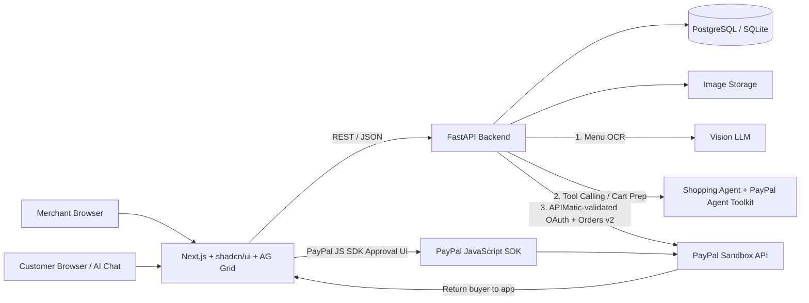

# Snap-a-Store — System Architecture & Hackathon Build Plan

**Version:** v2 (Multi-Track Edition)

> **Goal:** Build a working AI-assisted, agent-ready commerce prototype that turns a photo of a small merchant's menu into an editable catalog, a shareable mobile storefront, and an agentic ordering node, completing checkout with PayPal Sandbox.

> *This document is a proposed implementation plan, not evidence of a completed integration or PayPal endorsement.*

---

## Table of Contents

1. [Target Prize Tracks](#1-target-prize-tracks)
2. [Product Goal & Definition of Done](#2-product-goal--definition-of-done)
3. [Scope](#3-scope)
4. [System Architecture](#4-system-architecture)
5. [Technology Stack & Sponsor Integrations](#5-technology-stack--sponsor-integrations)
6. [Core User Flows](#6-core-user-flows)
7. [AI & Agentic Integration Design](#7-ai--agentic-integration-design)
8. [PayPal Sandbox & APIMatic Integration](#8-paypal-sandbox--apimatic-integration)
9. [Frontend Routes & UI Layout](#9-frontend-routes--ui-layout)
10. [Repository Layout](#10-repository-layout)
11. [Data Model](#11-data-model)
12. [Phased Build Milestones](#12-phased-build-milestones)
13. [3-Minute Demo Video Script](#13-3-minute-demo-video-script)
14. [Pre-Coding & Submission Checklist](#14-pre-coding--submission-checklist)

---

## 1. Target Prize Tracks

| # | Track | Prize | How Snap-a-Store Targets It |
|---|-------|-------|-----------------------------|
| 1 | Overall Top 3 + Best Use of PayPal + AI | $12k / $8k / $5k + $5k | Full vertical slice: photo → catalog → storefront → PayPal checkout |
| 2 | Best Use of Agentic Commerce | $5k | Dual storefront + AI Shopping Agent using PayPal Agent Toolkit / MCP primitives |
| 3 | Best Use of AG Grid | $10k pool (5 winners) | Inline catalog review editor + live merchant order reconciliation grid |
| 4 | Best Use of APIMatic | $3k pool (3 winners) | PayPal Orders v2 service layer generated/validated via APIMatic's PayPal Context Plugin |
| 5 | Best Demo Delivery + Most Impactful | $5k + $5k | Empowering micro-merchants with instant digital and agentic storefronts |

---

## 2. Product Goal & Definition of Done

Snap-a-Store helps micro-merchants who sell from handwritten menus, printed lists, or chalkboards create **a digital storefront and an AI-agent-discoverable ordering node in under 60 seconds**.

### End-to-end demo must show

1. **Upload** — Merchant uploads a handwritten or printed menu image.
2. **Vision extraction** — A real AI integration extracts names, descriptions, categories, dietary tags, and prices into structured data, flagging ambiguous text.
3. **AG Grid human-in-the-loop review** — Merchant reviews, filters, and inline-edits the draft in an interactive AG Grid workspace. Nothing is published automatically.
4. **Publish storefront & agent node** — Public URL, printable QR code, and an active agentic commerce (tool/MCP) endpoint.
5. **Dual buying experience**
   - *Standard flow:* Customer browses the mobile storefront, adds items to cart, checks out.
   - *Agentic flow:* Customer tells the AI Shopping Assistant, e.g. *"Order 2 dairy-free samosas and a mango lassi from Rina's Stall."* The agent queries the structured catalog, verifies dietary/price constraints, prepares a server-validated cart, and surfaces the PayPal approval button inside the chat.
6. **PayPal approval & server verification** — Backend (built with APIMatic-validated patterns) creates a PayPal Sandbox order; buyer explicitly approves via the PayPal JS SDK; backend captures and verifies payment.
7. **Live AG Grid order reconciliation** — Order status updates on the buyer receipt and the merchant's AG Grid order dashboard.

> A static mockup is not sufficient. The public repo must include full source, setup instructions, `.env.example`, and an explicit open-source `LICENSE`.

---

## 3. Scope

### MVP (must-have for submission)

- Seeded demo merchant (skip multi-tenant auth to focus on vertical-slice polish)
- Safe image upload and Vision AI extraction with strict Pydantic schema validation
- **AG Grid** editable review grid (highlighting `needs_review` rows inline) and saved catalog
- Publish/unpublish workflow → public storefront at `/store/[slug]` + downloadable QR code
- **Split-screen storefront:** visual cart on the left, AI Shopping Agent chat on the right
- **APIMatic-validated** PayPal Sandbox Orders v2 flow: `create` → buyer `approve` → server `capture`
- **AG Grid** merchant order dashboard with status (`pending`, `paid`, `failed`, `cancelled`) and TPV summaries
- Tests, README, license, and a tight 3-minute demo video

### Stretch goals (only after the core path is locked)

- Standard SSE/HTTP **MCP endpoint** (`/api/v1/mcp/stores/{slug}`) so external clients like Claude Desktop can query the store
- Multi-language menu auto-translation toggle
- PayPal webhook signature verification

### Non-goals

- Real-money payments
- Production onboarding / KYC
- Card-data storage
- Claiming PayPal endorsement
- Letting an AI agent auto-capture funds without explicit human buyer approval via the PayPal UI

---

## 4. System Architecture

A **modular monolith**: one FastAPI service owns business rules, persistence, Vision + Agent AI orchestration, tool definitions, and server-to-server PayPal calls. Next.js serves the merchant dashboard and the dual-mode customer storefront.



### Core engineering principles

| Principle | Rule |
|-----------|------|
| **Secrets stay on the server** | PayPal secret and AI API keys never touch the browser. |
| **Human-in-the-loop catalog** | AI output is a draft, never authoritative. Merchant must review in AG Grid and explicitly publish. |
| **Human-in-the-loop checkout** | The agent can search the catalog, filter, and create a pending local order, but payment approval is always done by the human via the official PayPal JS SDK button. |
| **Exact financial math** | Store all prices as integer minor units (e.g. `150` = $1.50). Never floats. |
| **Zero client trust** | Recalculate all totals server-side from database prices, whether from the cart or the agent. |
| **Verified capture only** | Never mark an order paid from a browser redirect/callback alone. |

---

## 5. Technology Stack & Sponsor Integrations

| Layer | Choice | Responsibility & Prize Alignment |
|-------|--------|----------------------------------|
| Frontend | Next.js App Router, React, TypeScript | Merchant screens, dual-mode storefront, result pages |
| Data grids | AG Grid React (`ag-grid-react`) | **[$10k track]** Inline-editable AI menu review table, confidence cell renderers, merchant order ledger |
| UI components | Tailwind CSS, shadcn/ui, Lucide | Layout shell, dialogs, agent chat drawer, badges |
| Backend | FastAPI + Pydantic v2 | REST API, strict schema validation, agent tool execution |
| PayPal SDK / codegen | APIMatic PayPal Context Plugin + Orders API v2 | **[$3k track]** Generate/validate server-side Orders v2 and OAuth integration |
| Agentic layer | PayPal Agent Toolkit patterns + function calling / MCP | **[$5k track]** Natural-language store search, cart assembly, checkout preparation |
| Vision AI | Gemini 2.5 Flash / GPT-4o (structured JSON output) | Extract item names, prices, dietary tags, OCR warnings |
| Database | SQLAlchemy 2 + Alembic (SQLite local / PostgreSQL) | Catalog, orders, extraction records, agent session logs |
| Payments UI | PayPal JS SDK (`@paypal/react-paypal-js`) | Official buyer approval modal in both cart and agent chat |

---

## 6. Core User Flows

### Flow A — Photo to Validated Catalog (Vision AI + AG Grid)

1. Merchant uploads a JPEG/PNG/WebP menu image.
2. Backend validates file type, signature, dimensions, and size; saves with a safe UUID filename.
3. Vision AI extracts names, descriptions, prices, categories, dietary tags, `source_text`, and warnings.
4. Backend validates output against a strict Pydantic schema. **Unreadable prices are forced to `null` with `needs_review = true`, never guessed.**
5. **AG Grid review screen:** source photo on the left, grid on the right with:
   - Amber/red badges for rows where `needs_review == true` or `price == null`
   - Inline editing for Name, Category, Description, Price
   - Instant filter ("Show only items needing review") and category grouping
6. Merchant fixes flagged cells, saves the draft, and clicks **Publish Store & Agent Node**.

### Flow B — Dual Storefront: Standard & Agentic Checkout

1. Customer opens `/store/{slug}` (link or QR scan).
2. Two ways to shop:
   - **Panel 1 — Visual menu:** browse cards, "Add to Cart", see server-calculated total.
   - **Panel 2 — AI Shopping Agent:** e.g. *"I have $10. Get me 2 spicy vegetarian snacks and a drink."*
3. **Agent tool execution:**
   - Agent calls `list_store_catalog` against the published catalog.
   - Agent proposes a cart and calls `build_validated_cart`.
   - Backend validates products, store status, quantities, and DB prices, creates a local `pending` order, and returns `order_id` + server-computed total.
4. **PayPal order creation (APIMatic-validated service):**
   - Frontend calls `POST /api/v1/payments/paypal/create-order` with the local `order_id`.
   - Backend gets a PayPal OAuth token and creates an order (`intent: CAPTURE`) using the server-calculated amount.
5. **Explicit buyer approval:** the official PayPal JS SDK button renders for that order inside the agent chat bubble (or cart drawer). Buyer approves in the Sandbox popup.
6. **Server capture & verification:**
   - Frontend calls `POST /api/v1/payments/paypal/capture-order`.
   - Backend captures via Orders v2, verifies `COMPLETED`, checks amount and currency match the local order, and persists `paypal_capture_id`.
7. Chat receipt and `/checkout/success` both read `GET /api/v1/orders/{id}` to show the verified state.

### Flow C — Merchant Live Order & TPV Grid (AG Grid)

1. Merchant opens `/dashboard/orders`.
2. AG Grid shows live orders with:
   - Status badges (`paid`, `pending`, `cancelled`)
   - Order source (Web Cart vs. AI Agent)
   - PayPal Capture ID and timestamp
   - Pinned bottom summary row calculating **Total Payment Volume (TPV)**

---

## 7. AI & Agentic Integration Design

### 7.1 Vision extraction schema

```json
{
  "items": [
    {
      "name": "Vegetable Samosa",
      "description": "Crispy pastry filled with spiced potatoes and peas",
      "price": "1.50",
      "currency": "USD",
      "category": "Snacks",
      "dietary_tags": ["vegetarian", "dairy-free"],
      "source_text": "Veg Samosa - 1.50",
      "needs_review": false,
      "warnings": []
    }
  ],
  "overall_warnings": []
}
```

### 7.2 Vision system prompt

> Extract only products and prices visibly present in the menu image. Do not invent names, prices, or ingredients. Return JSON matching the schema. If a price or name is unreadable or ambiguous, set price to null, set needs_review to true, and explain why in warnings. Preserve exact visible text in source_text.

### 7.3 Agent tool definitions (MCP / function calling)

The Shopping Agent is bounded to **three read/prepare tools** and cannot move money without buyer UI approval.

| Tool | Signature | Behavior |
|------|-----------|----------|
| `list_store_catalog` | `(store_slug: str)` | Returns active published items with display prices, categories, and dietary tags. |
| `build_validated_cart` | `(store_slug: str, items: list[CartItemInput])` | Validates availability, computes exact subtotal in minor units, creates a pending local order, returns `{ local_order_id, itemized_receipt, total_display }` so the UI can mount the PayPal button. |
| `check_order_payment_status` | `(local_order_id: str)` | Queries the DB to confirm whether the PayPal capture completed. |

> **Note:** The original draft also referred to `search_store_catalog(slug, query, max_price, dietary_tag)` and `prepare_agent_order(...)`. These are unified above under the three tool names. If you want filtering by price/dietary tag, add those as optional parameters on `list_store_catalog`.

---

## 8. PayPal Sandbox & APIMatic Integration

- **PayPal Orders API v2** for server-side order creation/capture
- **PayPal JavaScript SDK** for the buyer approval UI
- **APIMatic PayPal Context Plugin** (in the IDE) to generate and validate backend PayPal client code

### Endpoints

| Method | Path | Purpose |
|--------|------|---------|
| `POST` | `/api/v1/payments/paypal/create-order` | Accepts `{ local_order_id }`; looks up server-calculated total; creates a Sandbox order with `CAPTURE` intent. |
| `POST` | `/api/v1/payments/paypal/capture-order` | Accepts `{ local_order_id, paypal_order_id }`; captures server-side; verifies amount/currency/status; persists capture ID. |
| `GET` | `/api/v1/orders/{id}` | Returns persisted, server-verified order state. |

### Payment safety rules

- Never expose `PAYPAL_CLIENT_SECRET` or OAuth tokens to the browser.
- Never trust a client- or LLM-supplied total; always compute from `Product.price_minor * quantity` in the DB.
- Make capture **idempotent**: if `Order.status == "paid"`, return existing verified capture details without calling capture again.

---

## 9. Frontend Routes & UI Layout

| Route | Purpose | Highlight |
|-------|---------|-----------|
| `/` | Landing page with "Try Demo Store" and "Merchant Dashboard" buttons | Fast judge onboarding |
| `/dashboard` | Merchant overview and TPV KPI cards | shadcn/ui metrics |
| `/dashboard/catalog/new` | Upload menu photo, trigger Vision extraction | Live progress + sample menu fallback |
| `/dashboard/catalog/[id]/review` | Side-by-side menu photo + AG Grid editor | Inline editing, validation badges, filtering |
| `/dashboard/orders` | Live order ledger and TPV aggregation | AG Grid status filters, Agent vs. Web badge, CSV export |
| `/store/[slug]` | Public storefront: visual cart + AI Shopping Agent | Live agentic chat + inline PayPal checkout |
| `/checkout/success` | Verified receipt with PayPal Order & Capture IDs | Server-verified persistence |
| `/checkout/cancel` | Graceful cancelled/retry state | Error resilience |

---

## 10. Repository Layout

```
snap-a-store/
  frontend/
    app/
    components/
      ui/
      catalog/
        CatalogReviewGrid.tsx      # AG Grid: AI draft editing
      dashboard/
        OrdersLedgerGrid.tsx       # AG Grid: order tracking
      storefront/
        ProductList.tsx
        AgentShoppingChat.tsx      # Agent chat + inline PayPal button
      checkout/
        PayPalCheckoutButton.tsx
  backend/
    app/
      main.py
      core/config.py
      api/v1/
        ai.py                      # Vision extraction endpoints
        agent.py                   # Shopping Agent chat + tool execution
        catalog.py                 # Draft save & edit
        stores.py                  # Publish & public storefront
        orders.py                  # Local order creation & status lookup
        payments.py                # PayPal create-order & capture-order
      services/
        ai_extraction_service.py   # Vision LLM + Pydantic validation
        shopping_agent_service.py  # Tool-calling agent for cart prep
        paypal_service.py          # Built/validated with APIMatic plugin
      models/
      schemas/
      tests/
  docs/
    architecture.md
    apimatic-integration.md        # Screenshots/notes for APIMatic judges
  LICENSE
  README.md
  .env.example
```

---

## 11. Data Model

| Entity | Fields |
|--------|--------|
| **Merchant** | `id`, `display_name`, timestamps |
| **Store** | `id`, `merchant_id`, `name`, unique `slug`, `status` (draft/published), `currency`, timestamps |
| **Product** | `id`, `store_id`, `name`, `description`, `price_minor` (int; nullable in draft, non-null on publish), `currency`, `category`, `dietary_tags` (JSON), `source_text`, `ai_needs_review` (bool), `is_active` (bool) |
| **AIExtraction** | `id`, `image_path`, `status`, `model_name`, `result_json`, `error_code`, timestamps |
| **Order** | `id`, `store_id`, `source` (web \| ai_agent), `status` (pending \| paid \| failed \| cancelled), `currency`, `subtotal_minor`, `total_minor`, `paypal_order_id`, `paypal_capture_id`, timestamps |
| **OrderItem** | `id`, `order_id`, `product_id`, `product_name_snapshot`, `unit_price_minor_snapshot`, `quantity`, `line_total_minor` |

---

## 12. Phased Build Milestones

### Phase 0 — Scaffold & Integration Spikes (Day 1)

- [ ] Create public repo, MIT `LICENSE`, `.gitignore`, `.env.example`
- [ ] Scaffold Next.js (shadcn/ui + `ag-grid-react`) and FastAPI
- [ ] Install APIMatic PayPal Context Plugin; verify Sandbox OAuth → Create Order → Capture end-to-end
- [ ] Verify Vision extraction on one handwritten menu image

**Exit criteria:** PayPal Sandbox capture and Vision JSON extraction both work in isolation.

### Phase 1 — Vision Extraction + AG Grid Review (Day 2)

- [ ] Upload endpoint + Vision AI Pydantic validator
- [ ] `/dashboard/catalog/[id]/review` with source photo beside `CatalogReviewGrid.tsx`
- [ ] Highlight `needs_review` rows in amber
- [ ] Block publishing until all active rows have a valid integer `price_minor > 0`

**Exit criteria:** Merchant uploads a menu, fixes a flagged price inline, and publishes the store.

### Phase 2 — Storefront + Agentic Shopping Flow (Day 3)

- [ ] `/store/[slug]` with visual menu cards + QR code generator
- [ ] `shopping_agent_service.py` and `AgentShoppingChat.tsx`

**Exit criteria:** Both manual cart clicks and natural-language agent prompts produce a server-validated pending local order.

### Phase 3 — PayPal Checkout + AG Grid Order Ledger (Day 4)

- [ ] Connect PayPal JS SDK button to the cart drawer and the agent chat bubble
- [ ] Server-side capture verification and status persistence
- [ ] `/dashboard/orders` with `OrdersLedgerGrid.tsx` showing `ai_agent` vs. `web` orders and TPV

**Exit criteria:** Approving payment inside the agent chat marks the order `paid` and shows it immediately in the merchant's AG Grid dashboard.

### Phase 4 — Polish, Testing & Video (Day 5)

- [ ] pytest tests for minor-unit math, AI schema validation, idempotent payment state transitions
- [ ] README documents APIMatic, AG Grid, and Agentic Commerce integrations with badges/screenshots
- [ ] Record the 3-minute demo video

---

## 13. 3-Minute Demo Video Script

| Time | Segment | What to Show |
|------|---------|--------------|
| 0:00–0:20 | **The hook** | Real photo of a handwritten street-food menu. Micro-merchants are locked out of digital and AI-agent commerce. |
| 0:20–0:55 | **Vision AI + AG Grid review** | Upload the photo. Vision AI extracts items and dietary tags, flags one smudged price as Needs Review. Fix it inline in AG Grid, click **Publish Store & Agent Node**. |
| 0:55–1:45 | **Agentic Commerce moment** | Open `/store/rinas-stall` with QR code and split-screen agent. Type: *"I have $6—find me two dairy-free snacks and a drink."* Agent queries the catalog, computes the exact server total ($4.50), and renders the PayPal Sandbox button inside the chat. |
| 1:45–2:25 | **PayPal capture + APIMatic** | Approve with the Sandbox buyer account; show the APIMatic-built backend verifying and capturing. Refresh to prove persisted status. |
| 2:25–3:00 | **Merchant impact + AG Grid ledger** | Orders dashboard shows the new PAID order tagged *Source: AI Agent*, the PayPal Capture ID, and live TPV. Close with an architecture recap. |

---

## 14. Pre-Coding & Submission Checklist

- [ ] **Devpost:** explicitly select every eligible track in the submission dropdown — Best Use of Agentic Commerce, Best Use of AG Grid, Best Use of APIMatic, Most Impactful, Best Demo Delivery.
- [ ] **README:** add a section near the top titled **"🏆 Hackathon Track & Sponsor Integrations"** with three bullets pointing judges to:
  - **PayPal Agentic Commerce** → `shopping_agent_service.py`
  - **AG Grid** → `CatalogReviewGrid.tsx` and `OrdersLedgerGrid.tsx`
  - **APIMatic** → `paypal_service.py`
- [ ] Confirm `LICENSE`, `.env.example`, and setup instructions are in the public repo.
- [ ] Verify prize amounts and track rules against the official hackathon page before submitting.
